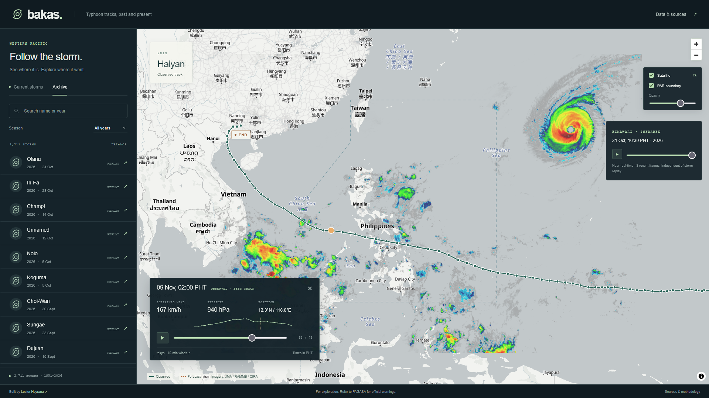

# Bakas

Typhoon tracks, past and present. A Western Pacific storm explorer with current PAGASA tracks, historical playback, and near-real-time Himawari imagery.

Built with Next.js, TypeScript, and MapLibre. Historical tracks are static files generated from NOAA IBTrACS. No database or analytics.

Data: [NOAA IBTrACS](https://www.ncei.noaa.gov/products/international-best-track-archive), [DOST-PAGASA Panahon](https://www.panahon.gov.ph/), and [RAMMB/CIRA SLIDER](https://slider.cira.colostate.edu/). Not an official warning service.

[Development & deployment](docs/DEVELOPMENT.md) · [Data provenance](docs/DATA.md)
